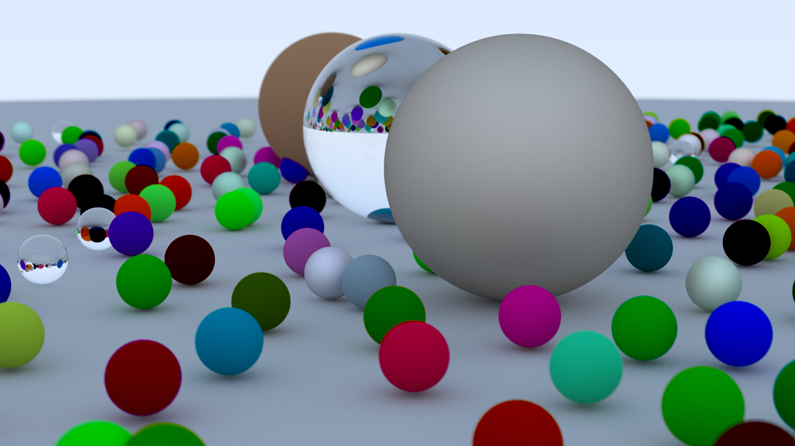
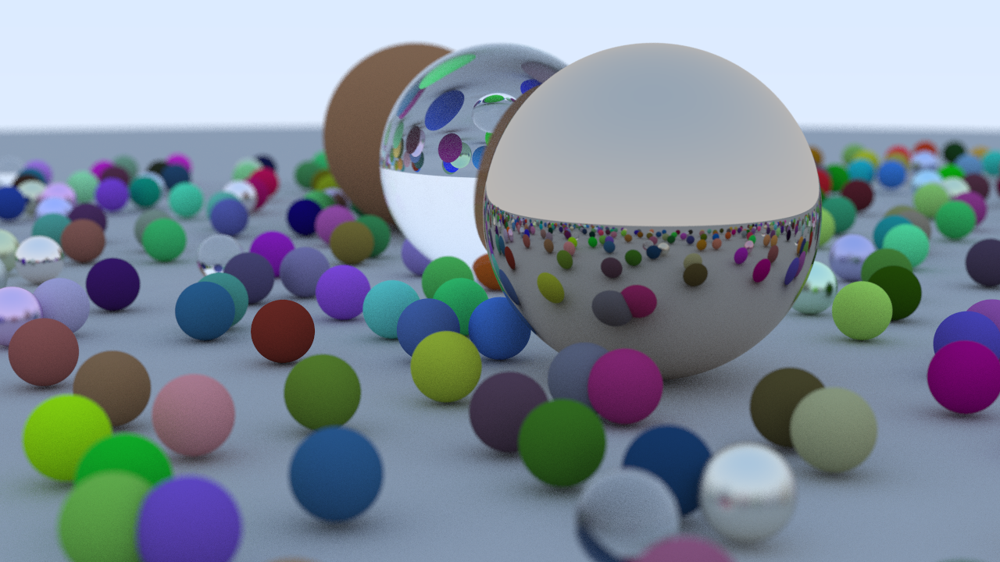

# Ray Tracing in One Weekend (1st Week) — Rust / Julia 追実装

> 『Ray Tracing in One Weekend』の第1部を、Rust と Julia でそれぞれ追実装した学習リポジトリです。レイトレーシングの基礎を段階的に実装し、Rayon / Julia Threads による並列化と簡単な性能計測まで記録しています。

## デモ

| Rust `final_render` | Julia `AFinalRender` |
|:---:|:---:|
|  |  |
| 1280×720 / 512 spp / depth 64 | 1280×720 / 128 spp / depth 64 |

Rust の高解像度版（1920×1080 / 1024 spp / depth 1024）は [こちら](Rust/result/20250304233401_09_oreore_final.png)。

> 乱数シード・カメラ設定・実装段階の違いにより、Rust と Julia で同じシーン構成でも見た目は一致しません。spp は samples per pixel（1画素あたりのサンプル数）、depth はレイの最大反射深度を表します。

## このリポジトリについて

書籍の C++ 実装をそのまま写すのではなく、各言語の機能を使って再設計することを目的としています。最終シーンは約500個の球を配置したランダムシーンで、Lambertian / Metal / Dielectric の3種類のマテリアルを混在させています。

- **Rust 版**：学習の各段階を独立した Cargo プロジェクトとして保存。最終的に Rayon で画素並列化。
- **Julia 版**：数式の導出を Jupyter Notebook に記録し、最終版を `AFinalRender.jl` に集約。`Threads.@threads` でサンプル並列化。
- **性能計測**：シリアル版と並列版の実行時間をテキストログとして保存。

### 見どころ

- レイ・球交差、法線、複数オブジェクト、アンチエイリアシング
- Lambertian / Metal / Dielectric のマテリアル、Schlick 近似、全反射
- 位置合わせ可能なカメラと薄レンズ近似による被写界深度
- Rust の `enum` による静的ディスパッチ、`Arc` によるマテリアル共有、Rayon による画素並列化
- Julia の型パラメータ付き構造体、多重ディスパッチ、`Threads.@threads` によるサンプル並列化
- 書籍の数式を自分で追った Notebook と、実際の出力画像・計測ログ

### 技術スタック

| 領域 | 使用技術 |
|---|---|
| 言語 | Rust 2021 / Julia 1.8.5 |
| 線形代数 | `nalgebra` / `LinearAlgebra` |
| 画像出力 | `image` / `Images.jl`, `ImageIO` |
| 乱数 | `rand` + `rand_xoshiro`（`Xoshiro256**`）/ `Random.Xoshiro` |
| 並列化 | Rayon / `Threads.@threads` |
| 記録 | Jupyter Notebook / PowerShell `Measure-Command` |

## 実装のポイント

### Rust

- `Visible`（`Sphere` / `World`）と `Material`（`Lambertian` / `Metal` / `Dielectrics`）を列挙型で表現し、`match` で分岐。
- `RayHittable` トレイトのデフォルト実装に再帰的な `color_rec` を置き、`Sphere` と `Visible::World` が共通のインターフェースを持つ設計。
- `nalgebra` の `Point3<f64>` / `UnitVector3<f64>` でベクトル演算を整理。
- `Camera::render` は `image::RgbImage` の各画素を Rayon で並列処理。スレッドごとに `Xoshiro256**` の RNG を用意し、`Mutex` で排他。
- `fuzzy_mt` で初めて Rayon を導入し、以降の `final_render` に継承。

主なファイル：

- [`Rust/final_render/src/ray_tracer.rs`](Rust/final_render/src/ray_tracer.rs) — カメラ、レンダリング、並列化
- [`Rust/final_render/src/ray_tracer/visible.rs`](Rust/final_render/src/ray_tracer/visible.rs) — ヒッタブル、再帰的なレイ色計算
- [`Rust/final_render/src/ray_tracer/visible/material.rs`](Rust/final_render/src/ray_tracer/visible/material.rs) — マテリアルと散乱

### Julia

- `Ray{T,C}`、`SphereWithMat{T,C,D}` など型パラメータ付き構造体で、数値型とベクトル型を抽象化。
- `Lambertian` / `FuzzyMetal` / `Dielectric` を `abstract type Material` の下に定義し、`scatter` を多重ディスパッチ。
- `Threads.@threads` でサンプル方向に並列化。サンプルごとに RNG とフレームバッファを割り当て、最後に平均。
- Snell の法則、Schlick 近似、薄レンズ近似などの導出を Notebook に記録。

主なファイル：

- [`Julia/1stWeekNotebook.ipynb`](Julia/1stWeekNotebook.ipynb) — 数式の導出と段階的な実装
- [`Julia/AFinalRender.jl`](Julia/AFinalRender.jl) — 最終版レンダラ

## 実装ステージ

Rust 版は、書籍の章に対応したスナップショットをディレクトリ単位で残しています。

| 段階 | ディレクトリ | 内容 |
|---|---|---|
| 1 | `sphere`, `normal_and_multi` | 球の描画、法線、複数オブジェクト |
| 2 | `anti_aliasing` | ピクセルあたり複数サンプル |
| 3 | `diffuse`, `limited_diffuse`, `remove_acne`, `lambertian`, `gamma` | 拡散反射、深度制限、shadow acne、真の Lambertian、ガンマ補正 |
| 4 | `metal`, `fuzzy`, `fuzzy_mt` | 金属、ファジー反射、Rayon による並列化 |
| 5 | `dielectrics`, `total_internal_reflection`, `schlick_approximation` | 誘電体、全反射、Schlick 近似 |
| 6 | `viewing_geometory`, `positioning_and_orienting` | 視野角、カメラの位置合わせ |
| 7 | `defocus_blur` | 薄レンズ近似による被写界深度 |
| 8 | `final_render`, `oreore_final` | 最終シーン、高解像度版 |

各ディレクトリは独立した Cargo プロジェクトです（workspace ではありません）。`Cargo.lock` もプロジェクトごとに保持しています。`Rust/result/` には最終結果だけでなく、試行錯誤の途中結果（ファイル名に `wrong` を含むもの）も残しています。

## 性能計測

### 計測方法

- **Rust**：リリースビルドしたバイナリを PowerShell の `Measure-Command` で計測。結果は `Rust/result/*_performance.txt` に保存。
- **Julia**：`julia -t N` でスレッド数を指定して実行。結果は `Julia/outputs/*_time.log` に保存。
- 計測は当時のローカル環境で 1 回ずつの手動実行です。CPU・メモリ・OS はログに残っていないため、絶対値は参考値として扱ってください。

### Rust（Rayon）

| プログラム | 並列化 | 解像度 | spp | 最大深度 | 時間 |
|---|---|---:|---:|---:|---:|
| `fuzzy` | なし | 1280×720 | 128 | 64 | 27.38 s |
| `fuzzy_mt` | Rayon | 1280×720 | 128 | 64 | 5.17 s |
| `final_render` | Rayon | 1280×720 | 512 | 64 | 525.68 s |
| `oreore_final` | Rayon | 1920×1080 | 1024 | 1024 | 1719.16 s |

同一シーン・同一設定の `fuzzy` → `fuzzy_mt` では、**約 5.3 倍**の速度向上が得られています。このペアが、並列化の効果を直接示す比較です。

### Julia（Threads.@threads、当時の計測ログ）

以下は当時の Notebook / スクリプトで得られたログです。現在の `AFinalRender.jl` は 1280×720 / 128 spp / depth 64 を既定値としているため、384×216 の行は当時の実行条件の記録です。

| プログラム | 解像度 | spp | 最大深度 | スレッド | 時間 |
|---|---|---:|---:|---:|---:|
| `AFinalRender`（HD） | 1280×720 | 128 | 64 | 16 | 19490.94 s（5時間24分51秒） |
| `AFinalRender` | 384×216 | 1024 | 1024 | 16 | 15785.30 s（4時間23分5秒） |
| `AFinalRender` | 384×216 | 128 | 64 | 8 | 1853.76 s（30分54秒） |
| `AFinalRender` | 384×216 | 4 | 2 | 4 | 50.64 s |

> Julia 版の数値は Rust 版と同一マシン・同一設定ではありません。また、スレッド数を変えたログ間でも条件が完全に統一されているとは限らないため、スケーリングの評価には同一環境での再計測が必要です。現状は「当時の実装と計測の記録」として掲載しています。

### 計測からわかったこと

- 画素並列は実装が比較的単純で、Rayon の導入だけで実用的な速度向上が得られた。
- Julia 版はサンプルごとに全画面バッファを持つ設計のため、メモリ消費が大きい。型安定性・アロケーション・並列粒度には改善余地がある。
- 同一条件でのプロファイリングと再計測が次の課題。

## リポジトリ構成

```text
.
├── Rust/
│   ├── sphere/ ... normal_and_multi/          # 第5-6章
│   ├── anti_aliasing/                         # 第7章
│   ├── diffuse/ ... gamma/                    # 第8章
│   ├── metal/ fuzzy/ fuzzy_mt/                # 第9章
│   ├── dielectrics/ ... schlick_approximation/ # 第10章
│   ├── viewing_geometory/ positioning_and_orienting/ # 第11章
│   ├── defocus_blur/                          # 第12章
│   ├── final_render/ oreore_final/            # 最終シーン
│   ├── result/                                # 出力画像・計測ログ
│   └── Measure-Performance.ps1
├── Julia/
│   ├── 1stWeekNotebook.ipynb                  # 数式メモ + 段階実装
│   ├── AFinalRender.jl                        # 最終レンダラ
│   ├── Project.toml / Manifest.toml
│   └── outputs/                               # 出力画像・計測ログ
├── .gitignore                                 # target/ や Julia/env/ を除外
└── README.md
```

## 動かし方

### 必要なもの

- Rust（edition 2021、stable）
- Julia 1.8.5 以降
- PowerShell 7（`pwsh`、Rust の計測スクリプトを使う場合）

### Rust

各プロジェクトは独立しているため、`Cargo.toml` を明示してビルドします。実行時のカレントディレクトリが `Rust/` でないと、出力先の `./result/` が見つからない点に注意してください。

```bash
cd Rust

# 最終レンダラをビルド
cargo build --release --manifest-path final_render/Cargo.toml

# Rust/ 直下で実行（出力は Rust/result/ に保存される）
./final_render/target/release/final_render
```

Windows では実行ファイルに `.exe` を付けます。

```powershell
.\final_render\target\release\final_render.exe
```

### Julia

```bash
cd Julia

# 依存パッケージをインストール
julia --project=. -e 'using Pkg; Pkg.instantiate()'

# 16 スレッドで最終レンダラを実行（出力パスは必須）
julia --project=. -t 16 AFinalRender.jl outputs/final.png
```

Notebook は Jupyter で `Julia/1stWeekNotebook.ipynb` を開いて実行できます。

### ベンチマークの再実行（Rust）

```bash
cd Rust

cargo build --release --manifest-path fuzzy/Cargo.toml
cargo build --release --manifest-path fuzzy_mt/Cargo.toml

pwsh ./Measure-Performance.ps1 fuzzy
pwsh ./Measure-Performance.ps1 fuzzy_mt
```

計測結果は `Rust/result/<タイムスタンプ>_<プログラム名>_performance.txt` に保存されます。

`Measure-Performance.ps1` は `.exe` を前提とした Windows 用スクリプトです。Linux / macOS では `/usr/bin/time -p ./fuzzy/target/release/fuzzy` などで代替してください。

## 今後の改善

- **Rust**：19 個の独立プロジェクトを Cargo workspace にまとめ、共通のレイトレーサをクレート化する。交差判定・マテリアルのユニットテスト、Criterion によるベンチマーク、CI を追加する。
- **Julia**：プロファイルに基づいて型安定性とアロケーションを改善し、サンプル並列から画素タイル並列へ変更する。Rust 版と同じシーン・同じマシンで再計測する。
- **共通**：シーンのパラメータを CLI から指定できるようにし、解像度・spp・深度・スレッド数の比較を自動化する。

## 出典

本リポジトリは Peter Shirley 氏の [『Ray Tracing in One Weekend』](https://raytracing.github.io/) を参考にした、学習目的の個人実装です。原書および原著コードの著作権は原著者に帰属します。
